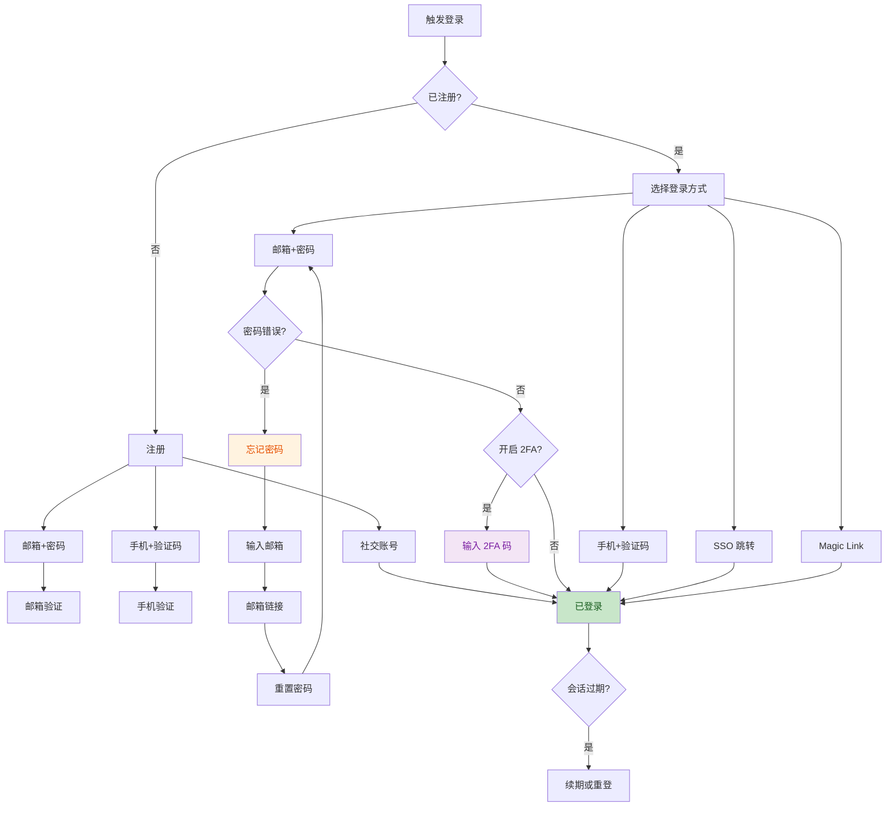

# Auth Flows — Category Workspace

> 本目录是 **Authentication & Authorization 类别专题**：登录/注册/找回密码/SSO/2FA/邮箱验证/手机验证。
>
> **关键区分**：跨应用一致性是最大价值。安全敏感：错误的 UX 直接导致账号泄露。

---

## 何时进入本目录

| 信号 | 必读路径 |
|---|---|
| 用户说"做登录注册 / 鉴权 / 找回密码" | 本目录 |
| 涉及 MFA/2FA | `component-contract/two-factor.md` |
| 涉及 SSO（Google/GitHub/Apple/SAML） | `component-contract/social-auth-buttons.md` |
| 涉及密码重置 | `component-contract/forgot-password.md` |
| 涉及手机/邮箱验证码 | `component-contract/otp-input.md` |
| 涉及 RBAC 角色/权限 UI 表现 | （建议合并 admin-panels/permission-ux.md） |
| 已确定做 auth | `meta-prompt.md` 选 OAuth/SAML/Magic Link 清单 |

**反例**（不要进本目录）：
- 商家后台 → `admin-panels/`
- 用户设置/账户管理 → `admin-panels/` 子集

---

## Auth 全链路地图



---

## 目录结构（MVI 目标态）

```
auth-flows/
├── README.md                       ← 你在这里
├── meta-prompt.md                  ← PHASE 4 预检 + OAuth/SAML/Magic Link 选型清单
│
├── # 组件层
├── component-contract/
│   ├── README.md
│   ├── sign-in-form.md            ★ 登录表单（邮箱/手机/SSO/记住我/忘记密码）
│   ├── sign-up-form.md            ★ 注册表单（密码强度/条款/隐私/必填）
│   ├── otp-input.md               ★ 验证码输入（4/6 位/自动跳格/粘贴支持/倒计时）
│   ├── password-input.md          ★ 密码输入（显示切换/强度条/眼睛图标）
│   ├── password-strength.md       ★ 密码强度（zxcvbn 集成/实时提示）
│   ├── two-factor.md              ★ 2FA（短信/邮箱/Authenticator/Backup Code）
│   ├── social-auth-buttons.md     ★ Google/Apple/GitHub/Microsoft 登录按钮
│   ├── forgot-password.md         ★ 忘记密码（输入邮箱→发送链接→重置）
│   ├── reset-password.md          ★ 重置密码（新密码+确认密码+强度）
│   ├── email-verify.md            ★ 邮箱验证（发送+链接+状态）
│   ├── phone-verify.md            ★ 手机验证（输入+验证码+实名可选）
│   ├── magic-link.md              ★ Magic Link 登录（输入邮箱→邮件链接→登录）
│   ├── sso-redirect.md            ★ SSO 重定向（跳转+回跳+错误处理）
│   ├── account-locked.md          ★ 账户锁定（提示+倒计时+解锁方式）
│   ├── session-expired.md         ★ 会话过期（提示+续期+重登）
│   ├── captcha.md                 ★ 验证码（reCAPTCHA/Turnstile/hCaptcha/极验）
│   ├── terms-checkbox.md          ★ 条款勾选（服务条款/隐私/营销）
│   └── error-banner.md            ★ 全局错误（顶部横幅+具体原因+解决建议）
│
├── # 布局层
├── layouts/
│   ├── README.md
│   ├── AF1-centered.md            居中卡片（最经典）
│   ├── AF2-split.md               左右分屏（品牌+演示+表单）
│   ├── AF3-modal.md               模态弹窗（内嵌于主应用）
│   ├── AF4-fullscreen.md          全屏沉浸（重置密码/首次登录）
│   └── AF5-stepper.md             多步流程（注册引导/2FA 启用）
│
├── # 经验层
├── pitfalls/                       ★ 15+ 条：安全/可访问性/UX
│   ├── README.md
│   ├── security.md                安全（密码明文/客户端校验/会话固定/XSS/CSRF）
│   ├── accessibility.md           可访问性（屏幕阅读/键盘导航/焦点管理）
│   ├── error-ux.md                错误 UX（错误信息泄露/区分大小写/通用提示）
│   └── rate-limiting.md           限速（登录尝试/重发邮件/IP 限制）
├── typography.md                   （字号档简化 / 错误/成功颜色突出）
├── ui-states.md                    ★ 8 状态扩展（加载/成功/失败/锁定/过期/验证中/验证失败/等待重发）
├── performance.md                  （轻量优先 / 少动画 / 表单提交响应快）
│
└── # 验证层
    └── verification/
        └── 4-2-clerk-style/       ★ 待建设：Clerk/WorkOS 风格参考实现
```

---

## 首选品牌参考

| 品牌 | 子类型 | 风格 |
|---|---|---|
| Clerk | 现代 Auth | 极简/Modal/组件化 |
| WorkOS | 企业 SSO | 极简/明亮/工程师风 |
| Auth0 | 全功能 | 多主题/可定制 |
| Supabase Auth | 集成式 | 极简/暗色/dev 友好 |
| Vercel Auth | 简化 | 一键登录/明亮 |
| Notion | 注册引导 | 极简/留白/亲和 |
| Linear | 登录/2FA | 极简/快捷键/暗色 |
| GitHub | 2FA/Backup | 工程师风/暗色 |
| Stripe | 注册流程 | 多步/极致细节/品牌色 |
| Magic.link | Magic Link | 极简/邮箱优先 |

---

## 安全/UX 必做（强制项）

### 安全（绝不能违反）
- ✅ 密码不在客户端校验（必须服务端）
- ✅ 不在错误信息泄露账号是否存在（"邮箱或密码错误" 而非 "邮箱不存在"）
- ✅ 不在 URL 携带敏感信息（token 放 body 或 HttpOnly cookie）
- ✅ 2FA 启用后必须要求启用 backup code
- ✅ 会话定期过期 + 活跃续期
- ✅ CSRF token 验证
- ✅ 限速（防爆破）
- ✅ HTTPS only
- ✅ CSP 头
- ✅ 不在 localStorage 存 token（XSS 风险）

### 可访问性（绝不能违反）
- ✅ 表单 label 与 input 关联
- ✅ 错误信息 aria-live 通知
- ✅ 键盘可达（Tab 顺序/Enter 提交/焦点可见）
- ✅ 验证码可读（屏幕阅读器友好）
- ✅ 颜色对比度 ≥ 4.5:1
- ✅ 倒计时可被屏幕阅读器读取

### UX 关键决策
- ✅ "忘记密码" 链接在登录页显著位置
- ✅ "创建账号" 链接在登录页显著位置
- ✅ 社交登录按钮按品牌顺序固定（不要随机）
- ✅ 错误信息给出**解决建议**（"密码错误，请重试" 而非 "401"）
- ✅ 提交按钮在请求中禁用（防双击）
- ✅ 自动填充友好（autocomplete 属性正确）
- ✅ 移动端键盘适配（email/tel/url 类型）

---

## 建设优先级

| 任务 | 优先级 | 预估 |
|---|---|---|
| ✅ 占位 README | P0 | done |
| `meta-prompt.md`（含选型清单） | P1 | 0.5d |
| `component-contract/sign-in-form.md` | P1 | 1d |
| `component-contract/sign-up-form.md` | P1 | 1d |
| `component-contract/password-input.md` | P1 | 0.5d |
| `component-contract/password-strength.md` | P2 | 0.5d |
| `component-contract/otp-input.md` | P1 | 0.5d |
| `component-contract/two-factor.md` | P2 | 1d |
| `component-contract/social-auth-buttons.md` | P1 | 0.5d |
| `component-contract/forgot-password.md` | P1 | 0.5d |
| `component-contract/reset-password.md` | P2 | 0.5d |
| `component-contract/email-verify.md` | P2 | 0.5d |
| `component-contract/phone-verify.md` | P2 | 0.5d |
| `component-contract/magic-link.md` | P2 | 0.5d |
| `component-contract/sso-redirect.md` | P2 | 0.5d |
| `component-contract/account-locked.md` | P2 | 0.5d |
| `component-contract/session-expired.md` | P2 | 0.5d |
| `component-contract/captcha.md` | P2 | 0.5d |
| `component-contract/error-banner.md` | P1 | 0.5d |
| `layouts/AF1-AF5` × 5 | P1 | 3d |
| `pitfalls/security.md` | P1 | 1d |
| `pitfalls/accessibility.md` | P1 | 0.5d |
| `pitfalls/error-ux.md` | P1 | 0.5d |
| `pitfalls/rate-limiting.md` | P2 | 0.5d |
| `ui-states.md` 8 状态扩展 | P1 | 0.5d |
| 第 1 个 verification（Clerk 风格） | P1 | 2d |
