# E-commerce — Category Workspace

> 本目录是 **E-commerce 类别专题**：消费者购物全链路（商品发现 → 详情 → 加购 → 结算 → 支付 → 订单跟踪 → 售后）。
>
> **关键区分**：与 `admin-panels/` 互补——**用户视角（买）** vs **商家视角（管库存/订单/营销）**。电商后台仍归 admin-panels。

---

## 何时进入本目录

| 信号 | 必读路径 |
|---|---|
| 用户说"做一个电商 / 商城 / 店铺 / 购物网站" | 本目录 |
| 涉及商品/购物车/支付 | `component-contract/product-card.md` + `cart-drawer.md` + `checkout-stepper.md` |
| 多步结算（地址→配送→支付→确认） | `layouts/P4-checkout.md` |
| 商品详情/变体/评价 | `component-contract/product-detail.md` + `review-rating.md` |
| 已确定做电商 | `meta-prompt.md` 选品+选支付渠道清单 |

**反例**（不要进本目录）：
- 商家后台（管商品/订单/营销） → `admin-panels/`
- 商品页营销展示（无购物车） → `saas-marketing/`
- 一次性活动商城 → `landing-pages/` 单页

---

## 电商全链路地图

```mermaid
flowchart LR
    A[商品发现 PLP] --> B[商品详情 PDP]
    B --> C[加购]
    C --> D[购物车]
    D --> E[结算 Step 1 登录]
    E --> F[结算 Step 2 地址]
    F --> G[结算 Step 3 配送]
    G --> H[结算 Step 4 支付]
    H --> I[下单成功]
    I --> J[订单跟踪]
    J --> K[收货+评价]
    K --> L[售后/退货]
    L --> A
    style A fill:#bbdefb,color:#0d47a1
    style B fill:#bbdefb,color:#0d47a1
    style D fill:#fff3e0,color:#e65100
    style E fill:#f3e5f5,color:#7b1fa2
    style H fill:#c8e6c9,color:#1a5e20
```



---

## 目录结构（MVI 目标态）

```
ecommerce/
├── README.md                       ← 你在这里
├── meta-prompt.md                  ← PHASE 4 预检 + 选品/支付渠道清单
│
├── # 组件层（消费者侧）
├── component-contract/
│   ├── README.md
│   ├── product-card.md            ★ 商品卡（图片/价格/促销/库存/评分）
│   ├── product-gallery.md         ★ 商品画廊（缩略图+主图+放大镜+视频）
│   ├── variant-picker.md          ★ 规格选择（颜色/尺码/容量，库存联动）
│   ├── price-display.md           ★ 价格展示（原价/促销价/会员价/分期）
│   ├── stock-indicator.md         ★ 库存指示（数字/进度条/缺货预警）
│   ├── cart-drawer.md             ★ 购物车侧栏（数量+/小计/促销码/运费估算）
│   ├── checkout-stepper.md        ★ 结算步骤器（进度+步骤内容+可返回）
│   ├── shipping-selector.md       ★ 配送选择（方式+时间+费用）
│   ├── payment-selector.md        ★ 支付选择（信用卡/PayPal/Apple Pay/分期）
│   ├── address-form.md            ★ 地址表单（多地址/默认/地图选点）
│   ├── order-timeline.md          ★ 订单时间线（待付款→已发货→已签收）
│   ├── order-summary.md           ★ 订单摘要（商品+小计+运费+折扣+税+总计）
│   ├── review-rating.md           ★ 评价（星级+文字+图片+商家回复）
│   ├── search-filter-bar.md       ★ 搜索+筛选+排序+类目导航
│   ├── recommendation-row.md      ★ 推荐（看了又看/买了又买/相关）
│   └── promotion-banner.md        ★ 促销横幅（满减/折扣/限时）
│
├── # 布局层
├── layouts/
│   ├── README.md
│   ├── P1-plp.md                  商品列表页（Product Listing Page）
│   ├── P2-pdp.md                  商品详情页（Product Detail Page）
│   ├── P3-cart.md                 购物车（独立页或侧栏）
│   ├── P4-checkout.md             结算页（多步）
│   ├── P5-thank-you.md            下单成功
│   ├── P6-order-tracking.md       订单跟踪
│   ├── P7-account-orders.md       我的订单
│   ├── P8-account-addresses.md    我的地址
│   └── P9-homepage.md             商城首页（品牌+品类+精选+推荐+活动）
│
├── # 经验层
├── pitfalls/                       ★ 电商专属反模式
│   └── README.md
├── typography.md                   （复用 saas-marketing 60%）
├── ui-states.md                    （6 状态普适 + 7 状态：抢购中/无库存/价格变更/物流中/已签收/退款中）
├── performance.md                  ★ LCP 优先（首屏商品图）
│
└── # 验证层
    └── verification/
        └── 4-2-shopify-style/     ★ 待建设：Shopify 风格参考实现
```

---

## 首选品牌参考

| 品牌 | 子类型 | 风格 |
|---|---|---|
| Shopify | 通用电商 + 后台 | 极简/绿色品牌色/明亮 |
| Nike | 服装运动 | 大图/视频/品牌驱动 |
| Airbnb | 民宿体验 | 大图/地图/故事化 |
| Amazon | 综合零售 | 极致效率/密集列表 |
| Etsy | 手作/垂直 | 温馨/卡片化/长尾 |
| Pinterest | 视觉发现 | 瀑布流/图片主导 |
| Allbirds | 极简品牌 | 大留白/故事化/可持续 |
| Aesop | 高端美妆 | 极简/印刷感/慢节奏 |
| Warby Parker | DTC 眼镜 | 极简/试戴互动/订阅 |
| Glossier | 美妆 DTC | 极简/柔和/社区 |

---

## 与 `admin-panels/` 的边界

| 维度 | E-commerce（用户侧） | Admin Panels（商家侧） |
|---|---|---|
| 主视角 | 消费者 | 商家 |
| 主操作 | 浏览/加购/支付 | **CRUD 商品/订单/营销** |
| 主页面 | PLP/PDP/购物车/结算 | 商品管理/订单管理/库存/营销活动 |
| 主组件 | 商品卡/购物车/结算 | 表格/表单/批量操作 |
| 用户身份 | 游客/会员 | 商家/客服/运营 |
| 权限 | 简单的会员等级 | RBAC 复杂 |

**互补关系**：
- 电商**前台**（用户购物） → ecommerce/
- 电商**后台**（商家管理） → admin-panels/
- 共享 Design Token / 6 状态 / 性能预算

---

## 建设优先级

| 任务 | 优先级 | 预估 |
|---|---|---|
| ✅ 占位 README | P0 | done |
| `meta-prompt.md` | P1 | 0.5d |
| `component-contract/product-card.md` | P1 | 1d |
| `component-contract/cart-drawer.md` | P1 | 1d |
| `component-contract/checkout-stepper.md` | P1 | 1d |
| `component-contract/variant-picker.md` | P1 | 0.5d |
| `component-contract/price-display.md` | P2 | 0.5d |
| `component-contract/order-timeline.md` | P2 | 0.5d |
| `component-contract/review-rating.md` | P2 | 0.5d |
| `component-contract/search-filter-bar.md` | P1 | 0.5d |
| `component-contract/payment-selector.md` | P2 | 0.5d |
| `component-contract/address-form.md` | P2 | 0.5d |
| `layouts/P1-P9` × 9 | P1 | 9d |
| `pitfalls/` 10-15 条（购物车丢失/价格竞态/库存竞态/支付失败） | P1 | 1d |
| `ui-states.md` 7 状态扩展 | P1 | 0.5d |
| `performance.md`（LCP 优先） | P1 | 0.5d |
| 第 1 个 verification（Shopify 风格） | P1 | 2d |
